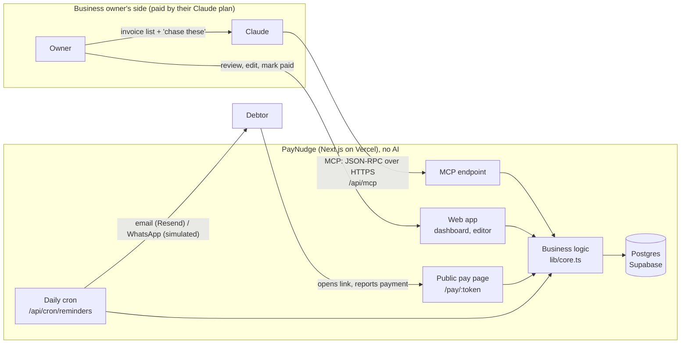

# PayNudge

**Claude writes the follow-ups. PayNudge chases the money.**

PayNudge helps small Indian B2B businesses get paid on time. The owner connects their own Claude to PayNudge over MCP. Claude reads their outstanding-invoice list (Excel, Tally screenshot, pasted table), judges each customer and writes a follow-up plan. PayNudge stores everything, hosts a payment page for every customer, sends reminders on schedule after the chat has ended, and stops them the moment an invoice is paid.

There is **no AI inside PayNudge**: no OpenAI, Anthropic or other model keys, SDKs or calls. Claude calls PayNudge; PayNudge never calls an AI.

---

## Architecture



### Data flow (the demo path)
1. The owner attaches an outstanding-invoice list in Claude and asks it to set up follow-ups.
2. Claude calls `get_collections_summary`, then `add_invoices` with the rows it read from the image or file.
3. For each overdue invoice Claude calls `get_invoice`. PayNudge returns the customer's payment history, which it computes itself (for example "pays 40 days late on average").
4. Claude writes a tone-matched reminder sequence and calls `create_followup_plan`. PayNudge validates and stores it, and the dashboard updates live.
5. The owner opens PayNudge, edits any message, date, channel or amount, and saves.
6. Every day the cron (or the **Run today's reminders** button) sends due reminders. Each one gets the customer's unique payment link.
7. The customer opens the link with no login and no Claude, sees the amount and payment details, and taps **I've made the payment**. PayNudge then pauses that invoice's reminders.
8. The owner confirms, or Claude marks it paid via `update_invoice`. All remaining reminders are cancelled automatically, and **Recovered this month** goes up.

### MCP tools
| Tool | What PayNudge does |
|---|---|
| `get_collections_summary` | Totals, ageing buckets, recovered this month, overdue invoices with no plan |
| `add_invoices` | Upserts customers, creates invoices, skips duplicates, validates dates and amounts |
| `list_invoices` | Filters by status and customer, computes days overdue and the next reminder |
| `get_invoice` | Detail, reminder plan, activity log, and the customer's computed payment history |
| `create_followup_plan` | Stores up to 6 reminders, replaces older pending ones, moves past dates to today |
| `update_invoice` | Mark paid or reopen (auto-stops reminders), edit amount, due date, contact or priority |

### Who does what
| Claude (customer's own plan) | PayNudge (this app) | Partners / production integrations |
|---|---|---|
| Reads invoice images, PDFs and Excel files | Stores invoices, customers, reminders and the audit log | **Email:** Resend (built, optional) |
| Judges each customer's risk and tone | Computes days overdue, ageing and payment history | **WhatsApp:** WhatsApp Business API (simulated) |
| Writes every reminder message | Sends reminders on schedule, adds pay links, stops them on payment | **Payments:** UPI collect or payment links, e.g. via Volopay or a payment gateway (simulated) |
| Answers "who owes me most?" in chat | Hosts the public payment page and the editable dashboard | **Accounting sync:** Tally / Zoho / Xero (next step) |

## What is built vs. simulated
**Built and working:**
- MCP server with 6 tools
- Live dashboard and invoice editor
- Reminder scheduling and sending engine
- Daily cron
- Public payment page with "I've paid" flow
- Automatic stop on payment
- Activity log that shows who did what (Claude, you, the customer, or PayNudge)
- Real email delivery when a Resend key is set

**Simulated (clearly labelled in the app):**
- **WhatsApp sending:** logged as "whatsapp (simulated)".
- **Email** without a Resend key: logged as "email (simulated)".
- **Payment collection:** UPI and bank details are demo values. The payment is not verified automatically; the owner confirms it.
- **Demo data:** a fictional company, "Kaveri Packaging", with fictional customers.

## Assumptions and limitations
- **Single workspace:** one demo business and one login. Production needs multi-tenant accounts and OAuth on the MCP endpoint, so each customer's Claude only sees their own data.
- **MCP endpoint:** open by default to make reviewer setup easy. Set `MCP_KEY` to require `?key=…`.
- **Currency and region:** INR only; dates in India time; daily reminder run at 09:00 IST.
- **No automatic payment detection:** this needs bank-feed or payment-gateway webhooks.

## Next steps
1. Multi-tenant sign-up and OAuth for the MCP connector.
2. WhatsApp Business API sending, including read receipts.
3. Real UPI payment links with auto-reconciliation via webhook, so "paid" is detected without the owner.
4. Two-way Tally / Zoho Books sync, so invoices arrive without uploading.
5. Recovery analytics: days-sales-outstanding (DSO) trend and money recovered per reminder sent.

---

## Run locally
```bash
npm install
npm run dev        # http://localhost:3000, uses an embedded Postgres (PGlite) in ./.pglite
```
Log in with `demo@paynudge.app` / `volopay2026`. The MCP endpoint is `http://localhost:3000/api/mcp`.

## Deploy (Supabase + Vercel, about 15 minutes)
1. **Supabase**: create a project (Mumbai region). Click **Connect** → **Transaction pooler** and copy the URI (port 6543). Replace `[YOUR-PASSWORD]` with your database password. The tables and demo data are created automatically on first request.
2. **GitHub**: push this folder to a new repo.
3. **Vercel**: Add New → Project → import the repo. Under Environment Variables add:
   - `DATABASE_URL` = the Supabase URI
   - `DEMO_PASSWORD` = `volopay2026` (or your own)
   - optional: `CRON_SECRET`, `RESEND_API_KEY`, `EMAIL_OVERRIDE_TO`, `MCP_KEY` (see `.env.example`)
4. Deploy. Open `https://<your-app>.vercel.app` and log in.

## Connect to Claude
1. claude.ai → **Settings → Connectors → Add custom connector**.
2. Name: `PayNudge`. URL: `https://<your-app>.vercel.app/api/mcp`.
3. In a chat, enable PayNudge from the **+ → Connectors** menu.
4. Attach `demo/outstanding-invoices.png` and ask: *"These are my unpaid invoices. Add them to PayNudge and set up follow-ups for everyone who's overdue."*

## Tech
Next.js 16 (App Router, server actions) · TypeScript · Postgres (Supabase), with PGlite locally · Vercel (hosting and cron) · Resend (optional email) · MCP over Streamable HTTP, implemented directly as stateless JSON-RPC in `app/api/mcp/route.ts`.
